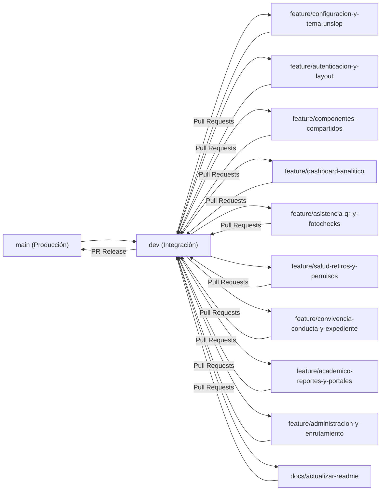

# SIAE — Frontend Web (`SIAE-Frontend`)

Aplicación Web Frontend para el **Sistema Integral de Gestión y Seguimiento Escolar mediante Identificación QR (SIAE)**, orientada a instituciones educativas de nivel secundaria (`1°` a `5°` grado).

Construida con **React 18 + Vite + Tailwind CSS**, bajo el sistema de diseño **Unslop** con soporte nativo dual para **Modo Claro (Sol)** y **Modo Oscuro (Luna)**, cliente HTTP con caché en memoria e invalidación automática, y gráficas analíticas vectoriales (`SVG`) adaptadas a cada perfil de usuario.

---

## Funcionalidades Principales

- **Acceso y Navegación por 7 Roles:** `ADMIN`, `DIRECTOR`, `TUTOR`, `DOCENTE`, `AUXILIAR`, `PADRE` y `ESTUDIANTE`, con rutas protegidas y menú dinámico.
- **Sistema Visual Dual (Unslop):** Alternancia instantánea entre **Modo Claro** y **Modo Oscuro** con jerarquía de superficies Carbon/Alabaster, tipografía tabular (`tabular-nums`) y preservación automática de contraste en fotochecks imprimibles.
- **Dashboard Analítico Institucional:** Banda ejecutiva unificada con los 12 KPIs institucionales, gráfica de dinámica diaria (10 días), gráficas de anillo (asistencia y semáforo conductual), columnas comparativas por aula (`1° "A"` a `5° "A"`), matriz de calor (*Heatmap*) y rankings horizontales con citación directa al apoderado.
- **Asistencia QR y Fotochecks:** Escáner en vivo con cámara web (`html5-qrcode`) y pistola USB, alertas visuales/sonoras, control manual auditado y emisión individual o masiva de fotochecks en PDF con regeneración segura por extravío.
- **Jornada Escolar (Salud, Retiros y Permisos):** Atención de situaciones de salud con confirmación del padre, retiros durante la jornada validando identidad de terceros autorizados y gestión de permisos con evidencias adjuntas.
- **Convivencia, Actas y Expediente Multianual:** Registro de incidencias con semáforo conductual (`0–100 pts`), citaciones, reuniones, actas descargables en PDF, compromisos y línea de tiempo cronológica del estudiante.
- **Selector Inteligente de Estudiantes:** Componente reutilizable con filtro previo por **Grado/Sección** y buscador en tiempo real por **DNI, apellidos, nombres o código QR**.
- **Portales de Familia y Estudiante:** Estado de asistencia en vivo, gráfica de anillo de asistencia, calendario mensual, solicitudes de permiso, confirmación de alertas de salud, autorización de terceros y fotocheck QR digital.

---

## Stack Tecnológico

| Categoría | Tecnologías |
| :--- | :--- |
| **Core** | React 18, Vite 5, React Router DOM 6 |
| **Estilos e Iconografía** | Tailwind CSS 3, PostCSS, Lucide React |
| **Comunicación API** | Axios (con interceptores JWT, deduplicación y caché GET en memoria) |
| **Códigos QR y Escáner** | `qrcode.react`, `html5-qrcode` |
| **Reportes e Impresión** | `jspdf`, `jspdf-autotable`, `html2canvas` |

---

## Estructura del Proyecto

```text
Frontend/
├── public/
│   ├── _redirects                    # Reglas SPA para despliegue en producción
│   └── favicon.svg                   # Ícono institucional SIAE
├── src/
│   ├── api/
│   │   └── client.js                 # Cliente Axios con JWT y caché con invalidación automática
│   ├── components/
│   │   ├── CarnetQRCard.jsx          # Fotocheck QR imprimible y descargable
│   │   ├── GraficaAnilloAsistencia.jsx # Gráfica SVG de asistencia para portales
│   │   ├── Layout.jsx                # Navegación responsiva por rol, notificaciones y tema Sol/Luna
│   │   ├── SelectorEstudiante.jsx    # Filtro por grado/sección y buscador por DNI o nombre
│   │   └── SemaforoBadge.jsx         # Insignia de semáforo conductual
│   ├── context/
│   │   ├── AuthContext.jsx           # Gestión de sesión JWT y rol activo
│   │   └── ThemeContext.jsx          # Persistencia y cambio de tema Claro/Oscuro
│   ├── pages/
│   │   ├── LoginPage.jsx
│   │   ├── DashboardPage.jsx
│   │   ├── EscanerQRPage.jsx
│   │   ├── AsistenciasAuditoriaPage.jsx
│   │   ├── CarnetsPage.jsx
│   │   ├── SaludRetirosPermisosPage.jsx
│   │   ├── ConductaPage.jsx
│   │   ├── ExpedienteEstudiantePage.jsx
│   │   ├── ActividadesDocentePage.jsx
│   │   ├── ReportesPage.jsx
│   │   ├── PortalPadrePage.jsx
│   │   ├── PortalEstudiantePage.jsx
│   │   └── UsuariosConfigPage.jsx
│   ├── utils/
│   │   └── exportadores.js           # Exportación PDF, Excel y actas formales
│   ├── App.jsx                       # Enrutamiento principal protegido por rol
│   ├── index.css                     # Tokens y estilos globales Unslop (Light/Dark)
│   └── main.jsx                      # Punto de montaje React
├── .env.example
├── index.html
├── tailwind.config.js
└── vite.config.js
```

---

## Instalación y Ejecución Local

### 1. Clonar e instalar dependencias

```bash
git clone https://github.com/EduMoralesCar/SIAE-Frontend.git
cd SIAE-Frontend
npm install
```

### 2. Configurar variables de entorno

Copia `.env.example` a `.env` y apunta a la URL de tu servidor Backend:

```env
VITE_API_URL=http://localhost:4000/api
```

### 3. Comandos disponibles

```bash
npm run dev      # Inicia servidor de desarrollo en http://localhost:5173
npm run build    # Genera el paquete optimizado de producción en dist/
npm run preview  # Previsualiza la compilación de producción localmente
```

---

## Cuentas de Prueba por Rol

Contraseña para todas las cuentas de demostración: **`123456`**

| Rol | Correo electrónico |
| :--- | :--- |
| **Administrador** | `admin@siae.edu.pe` |
| **Director** | `director@siae.edu.pe` |
| **Tutor** | `tutor1@siae.edu.pe` |
| **Docente** | `docente1@siae.edu.pe` |
| **Auxiliar** | `auxiliar1@siae.edu.pe` |
| **Padre / Apoderado** | `padre1@siae.edu.pe` |
| **Estudiante** | `alumno1@siae.edu.pe` |

---

## Arquitectura de Ramas (Git Flow)

El repositorio sigue un flujo **Git Flow** estructurado con commits atómicos en español bajo el estándar **Conventional Commits** (`feat`, `fix`, `chore`, `perf`, `docs`), integrando cada funcionalidad mediante **Pull Requests** hacia `dev` antes de promocionar a producción (`main`).



### Política de Ramas
- **`main`**: Rama principal estable lista para despliegue en producción. Solo recibe cambios mediante Pull Request desde `dev`.
- **`dev`**: Rama de integración continua donde convergen todas las ramas `feature/*` y `docs/*` tras su revisión.
- **`feature/<modulo>`**: Ramas independientes por módulo funcional con commits atómicos en español.
- **`docs/<tema>`**: Ramas dedicadas a mejoras de documentación técnica.

---

## Repositorio Relacionado
- **Backend API REST:** [SIAE-Backend](https://github.com/EduMoralesCar/SIAE-Backend)
